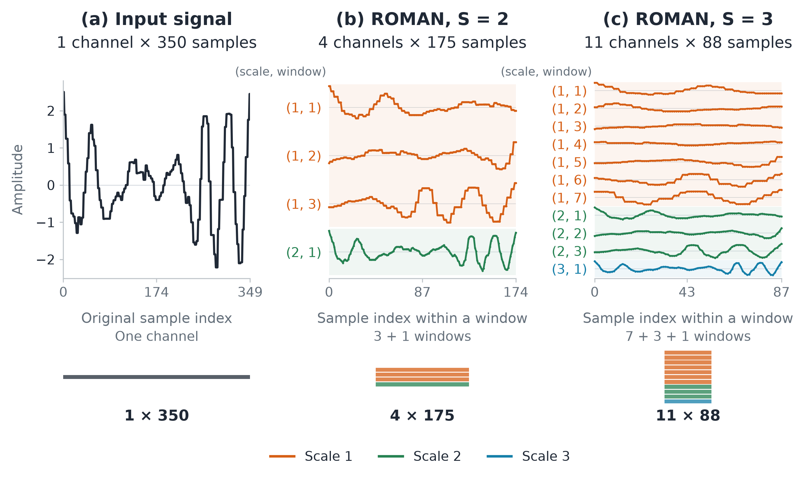
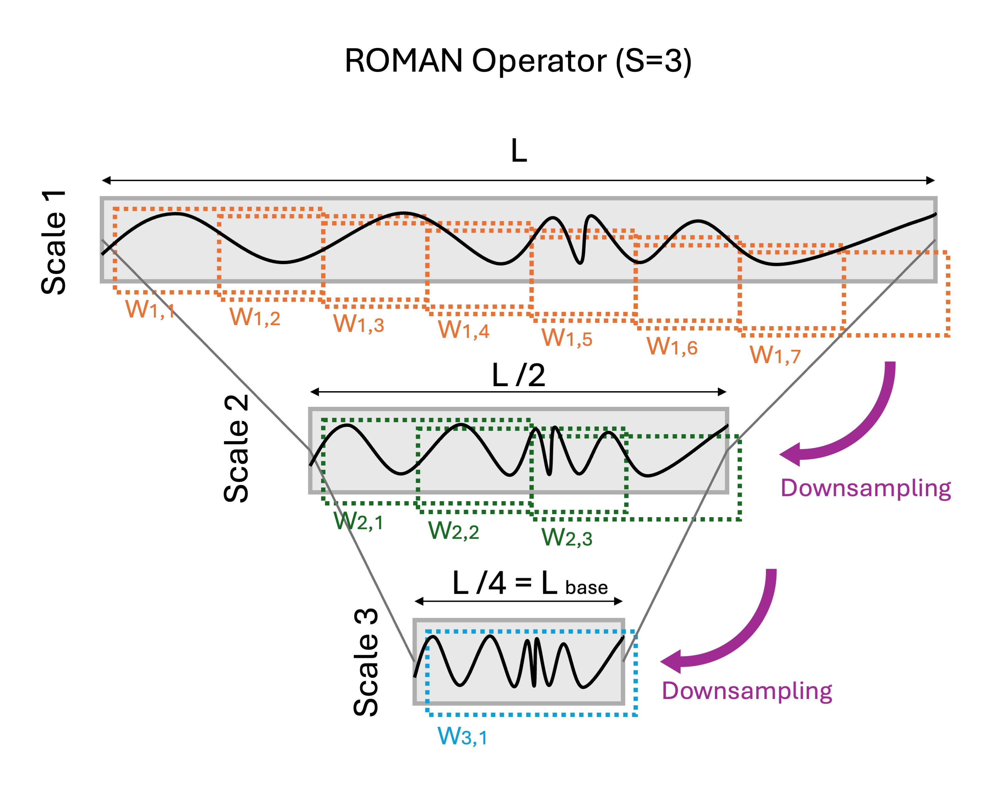

<p align="center">
  
</p>

# ROMAN

**Give convolutional time-series models a better view of temporal structure—with one preprocessing step.**

ROMAN (ROuting Multiscale representAtioN) turns a long time series into shorter channels indexed by scale and coarse temporal position. It gives standard classifiers direct access to information that temporal pooling can obscure, speeds up processing of long sequences, and creates complementary views for ensembles.

**Paper:** [ROMAN: A Multiscale Routing Operator for Convolutional Time Series Models](https://arxiv.org/abs/2604.02577) · **Author:** Gonzalo Uribarri

**Paper experiments and recorded results:** [gon-uri/ROMAN-paper](https://github.com/gon-uri/ROMAN-paper)

## Why ROMAN?

- **Expose useful temporal structure.** Make coarse position, distant local events and multiple temporal scales accessible through channel mixing.
- **Shorten the sequence your model processes.** A simple front-end can improve both accuracy and computational efficiency without changing the classifier's architecture.
- **Add diversity to ensembles.** Models trained with different routing scales can make complementary predictions.
- **Keep the workflow simple.** ROMAN needs no learned filters and works with MiniRocket, MultiRocket and temporal CNNs through a scikit-learn-style interface.

A favorable example from the paper's datasets:

| | MiniRocket | ROMAN S=4 + MiniRocket |
|---|---:|---:|
| Test accuracy | 80.56% | **96.33%** |
| Training time | 0.400 s | **0.182 s (2.2× faster)** |
| Inference time | 8.01 s | **3.70 s (2.2× faster)** |

*CinCECGTorso (UCR), 40 training and 1,380 test series, three seeds (0–2), `num_kernels=10_000`. Accuracy is averaged over seeds; training time is the median across fits; inference is the median across seeds of five warm predictions of the full test set. Both pipelines run in the same environment on one compute thread. Training includes preprocessing, feature extraction and classifier fitting; inference includes the complete series-to-label pipeline. Data loading and first-time compilation are excluded. [Run the notebook](notebooks/ucr_minirocket_example.ipynb) · [Measurements and environment](notebooks/results/cincecg_torso.json).*

The baseline uses the original inputs; ROMAN fits channel normalization on training inputs, following the paper's recorded MiniRocket protocol. On new data, choose S using validation results.

## Installation

Install the lightweight operator library:

```bash
pip install "git+https://github.com/gon-uri/ROMAN.git"
```

For the MiniRocket examples and notebooks:

```bash
pip install "roman-ts[examples] @ git+https://github.com/gon-uri/ROMAN.git"
```

For local development:

```bash
git clone https://github.com/gon-uri/ROMAN.git
cd ROMAN
pip install -e ".[examples]"
```

The package installs as `roman-ts` and is imported as `roman`. Optional extras: `plot` for relevance visualization and `examples` for the worked classification notebooks.

## Quick start: ROMAN + MiniRocket

Use ROMAN as the first step of a standard scikit-learn pipeline:

```python
import numpy as np
from sklearn.pipeline import make_pipeline
from sklearn.linear_model import RidgeClassifierCV
from sktime.datasets import load_UCR_UEA_dataset
from sktime.transformations.panel.rocket import MiniRocketMultivariate
from roman import RomanOperator

X_train, y_train = load_UCR_UEA_dataset(
    "CinCECGTorso", split="train", return_type="numpy3D"
)
X_test, y_test = load_UCR_UEA_dataset(
    "CinCECGTorso", split="test", return_type="numpy3D"
)

model = make_pipeline(
    RomanOperator(S=4, alpha=0.5),
    MiniRocketMultivariate(num_kernels=10_000, random_state=0, n_jobs=1),
    RidgeClassifierCV(alphas=np.logspace(-3, 3, 10)),
)
model.fit(X_train, y_train)
print(f"Test accuracy: {model.score(X_test, y_test):.2%}")
```

To use the representation with another classifier, transform your train and test sets directly:

```python
operator = RomanOperator(S=4, alpha=0.5)
Z_train = operator.fit_transform(X_train)
Z_test = operator.transform(X_test)
```

Inputs and outputs use `(cases, channels, time)`. For CinCECGTorso, S=4 changes `(40, 1, 1639)` into `(40, 26, 205)`: a shorter time axis with explicit scale and position channels. Channel normalization uses training statistics. S=1 preserves the input geometry; use `normalization=False` for the identity routing without normalization. The implementation returns float32 arrays.

A real **FaceFour** series illustrates how the same input becomes a set of shorter channels at **S=2** and **S=3** (alpha=0.5). Colors identify scales; the lower diagrams show the change in array shape.





## Better ensembles with mixed scales

The same representation idea can improve a simple ensemble. On **FaceFour**, a small UCR dataset with 24 training and 88 test series:

| | Five S=1 models | Mixed-scale ensemble |
|---|---:|---:|
| Test accuracy | 94.32% | **100.00%** |
| Correct test predictions | 83 / 88 | **88 / 88** |
| Members | 5 | 5 |
| Scales | 1, 1, 1, 1, 1 | 1, 1, 2, 3, 4 |

The mixed ensemble combines two raw-input models with three ROMAN views while keeping the same member count and per-member feature budget. The fixed seeds and hard-voting rule reproduce the paper's ensemble protocol. Shared members are reused, so the complete comparison needs only eight unique fits. [Run the quick ensemble notebook](notebooks/ensemble_example.ipynb) · [Measured example](notebooks/results/facefour_ensemble.json).

## Choosing S and alpha

- **Start with S=2–4.** Increasing S shortens the common time axis and routes more scale and coarse-position information into channels. The best setting depends on the task and backbone; validation data provides a practical way to choose among them.
- **Keep local patterns inside the finest windows.** `min_timesteps_per_channel` (default 32) limits the pyramid depth. Set it to preserve the temporal detail needed by your task.
- **Use alpha to control redundancy and cost.** The default is 0.5. In the paper's overlap study, alpha=0.25 used about 23% fewer pseudochannels with statistically indistinguishable accuracy from 0.5. At alpha=0.5, scales with multiple windows have approximately double interior coverage.
- **Mix scales to build complementary models.** A fixed ensemble can combine several views without choosing a single S for every member.
- **Take advantage of the shorter time axis.** It often reduces training and inference costs for ROCKET-style backbones, as the example above demonstrates. Larger channel counts and the downstream model also influence the final speedup.

ROMAN is especially useful when temporal layout or interactions across scales carry class information. Its effect depends on the information the backbone already captures and on whether positional sensitivity is useful for the task.

## Worked notebooks

- **[UCR classification: CinCECGTorso](notebooks/ucr_minirocket_example.ipynb)** — a large accuracy gain with lower training and prediction times; complete, warmed timing comparisons.
- **[Mixed-scale ensembles: FaceFour](notebooks/ensemble_example.ipynb)** — a fast five-member comparison where combining S=1–4 improves on five S=1 models.
- **[Multivariate classification: EthanolConcentration](notebooks/uea_example.ipynb)** — apply the same operator to three-channel UEA data.

The examples use public UCR/UEA splits and download data through sktime when it is not already cached. Dataset-specific examples illustrate useful operating points; the companion repository contains the full experiment population. Example measurements are fresh runs with their own recorded environment, separate from the paper's historical timing measurements.

## Main API

`RomanOperator` provides `fit`, `transform` and `fit_transform`. It accepts `(cases, time)` univariate arrays or `(cases, channels, time)` multivariate arrays. Supply exactly one scale-selection mode:

| Mode | Configuration |
|---|---|
| Exact scale | `RomanOperator(S=4)` |
| Channel budget | `RomanOperator(max_pseudochannels=64)` |
| Expected channel coverage | `RomanOperator(N=10_000, H=20)` |

In coverage mode, N counts the downstream transform's channel-subset draws; it is distinct from the number of output features. All modes respect `min_timesteps_per_channel` and the optional `S_max` cap.

Key parameters are `S`, `alpha=0.5`, `min_timesteps_per_channel=32`, and `normalization=True`. Useful fitted attributes include `S_`, `L_base_`, `lengths_`, `windows_`, `starts_`, `ends_` and `n_pseudochannels_`.

`choose_S_roman` exposes the same selection logic without transforming data. `map_relevance` projects pseudochannel importance onto the original channels/timeline and scales; `plot_relevance` visualizes those maps with the optional plotting dependencies.

## Paper reproduction

The separate **[ROMAN-paper repository](https://github.com/gon-uri/ROMAN-paper)** contains the benchmark runners, configurations, saved predictions, statistical analyses, and full recorded results. This library stays focused on installing and using the operator.

The paper's MiniRocket S=1 baseline bypasses ROMAN preprocessing; routed configurations include training-fitted channel normalization. The example notebooks preserve that recorded protocol.

## Citation

If you use ROMAN, please cite:

```bibtex
@misc{uribarri2026roman,
  title         = {ROMAN: A Multiscale Routing Operator for Convolutional Time Series Models},
  author        = {Uribarri, Gonzalo},
  year          = {2026},
  eprint        = {2604.02577},
  archivePrefix = {arXiv},
  howpublished  = {arXiv:2604.02577}
}
```

## License

MIT. See [LICENSE](LICENSE).
